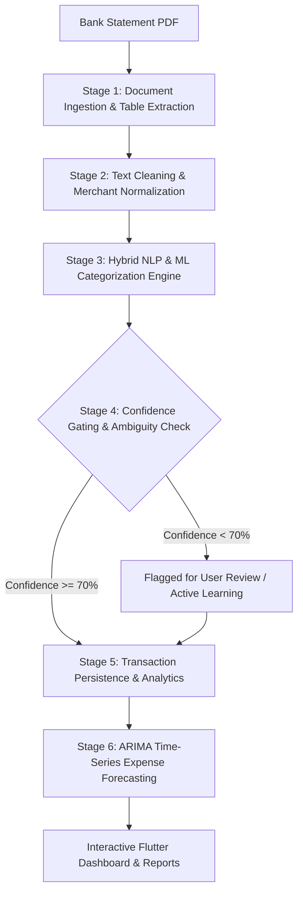
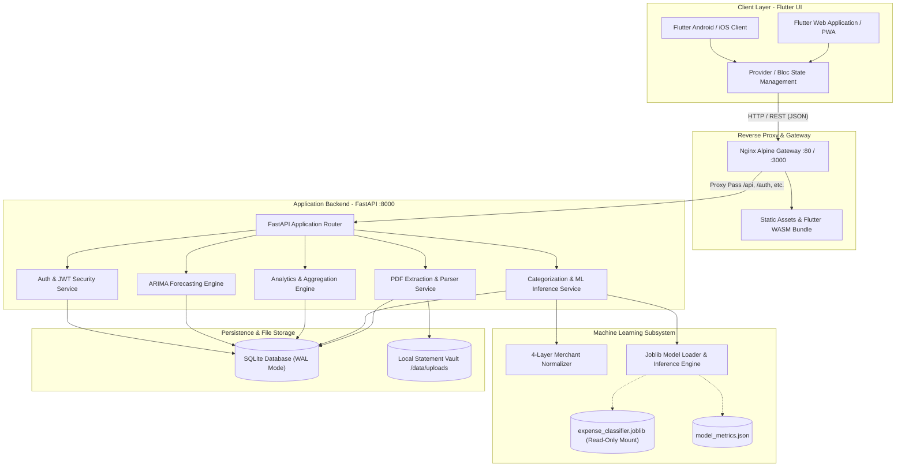
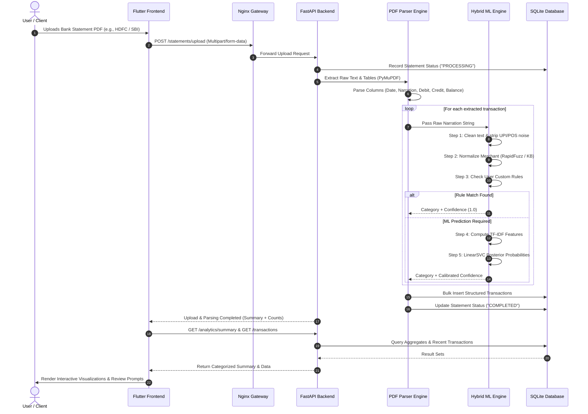
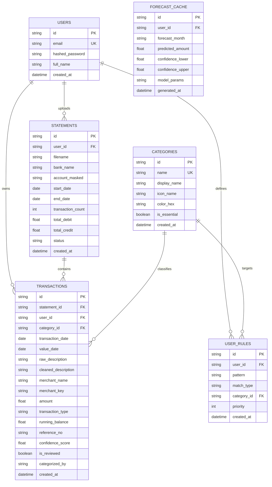

# ExpenseInsight — Proposed Methodology & System Architecture

**Document Version:** 1.0.0  
**Project:** ExpenseInsight (Intelligent Personal Finance & Statement Analytics Platform)  
**Target Environment:** Cross-Platform (Flutter Web & Mobile + FastAPI + Scikit-Learn / PyTorch + Docker)  

---

## 1. Executive Summary

**ExpenseInsight** is an end-to-end, privacy-first intelligent financial analytics system designed to transform messy, unstructured bank-statement PDFs into structured financial data, granular transaction categorization, automated spending insights, and predictive expense forecasting.

Bank statement descriptions are notoriously noisy, abbreviated, and non-standardized (e.g., `UPI/3249820192/SWIGGY/BANGALORE` vs. `POS 48392 AMAZON SELLER IN`). Traditional personal finance applications either rely on manual user entry or brittle, hardcoded keyword matching that fails across diverse banking institutions.

ExpenseInsight overcomes these limitations by combining:
1. **High-Precision Vector PDF Parsing**: Extracts tables and multiline transaction streams across diverse Indian banking formats (SBI, HDFC, ICICI, Axis, Kotak, PNB, etc.).
2. **4-Layer Merchant Normalization**: Strips banking protocol noise and resolves erratic merchant tokens to canonical entities via fuzzy sequence matching.
3. **Calibrated Hybrid Machine Learning Engine**: Blends rule-based deterministic precedence with a Sublinear TF-IDF + Calibrated Support Vector Machine (`LinearSVC` with Platt scaling) to produce accurate category labels accompanied by probability-calibrated confidence scores.
4. **Time-Series Expense Forecaster**: Employs Auto-ARIMA time-series modeling to project recurring and discretionary expenditures with 95% confidence intervals.
5. **Decoupled Containerized Architecture**: A modern microservice-ready stack utilizing Flutter for responsive Web/Mobile interfaces, FastAPI for high-throughput asynchronous inference, and a hot-swappable ML weight volume.

---

## 2. Proposed Methodology

The methodology follows a robust 6-stage data processing, NLP, and machine learning pipeline:



---

### Stage 1: Document Ingestion & High-Precision PDF Parsing

Bank statements are distributed as vector or scanned PDFs with inconsistent table structures, missing borders, multi-line descriptions, and variable column layouts.

1. **Extraction Engine**: Uses `PyMuPDF` (`fitz`) as the primary high-throughput extraction engine, falling back to `pdfplumber` for intricate table grid structures.
2. **Column & Boundary Resolution**:
   - Analyzes coordinate bounding boxes to map columns: `Transaction Date`, `Value Date`, `Description / Narration`, `Ref / Cheque No.`, `Debit`, `Credit`, and `Running Balance`.
   - Heuristically reconstructs multi-line wrapped descriptions (e.g., reference IDs spanning two rows) into a single atomic narration string.
3. **Transaction Disambiguation**:
   - Distinguishes debit (expense) vs. credit (income/transfer) using dedicated column values, explicit `Dr`/`Cr` suffixes, or +/- sign indicators.
   - Cleans numeric amounts by stripping currency symbols (`₹`, `INR`, `$`), commas, and handling Indian numbering notations (e.g., `1,00,000.00`).

---

### Stage 2: Text Preprocessing & 4-Layer Merchant Normalization

Raw banking narrations contain protocol prefixes, payment gateway IDs, terminal codes, branch identifiers, and timestamp noise.

#### Preprocessing & Sanitization:
- **Banking Protocol Stripping**: Regex engines identify and excise transactional noise prefixes:
  $$\text{Prefixes: } \texttt{UPI/}, \texttt{POS/}, \texttt{NEFT/}, \texttt{RTGS/}, \texttt{IMPS/}, \texttt{ACH/}, \texttt{BIL/}, \texttt{ATM/}$$
- **Reference & Noise Removal**: Strips 12-digit UPI reference numbers (RRN), authorization codes, and location suffixes (e.g., `BANGALORE IN`, `MUMBAI BR`).
- **Token Normalization**: Converts text to uppercase, removes special symbols, and eliminates redundant whitespace.

#### 4-Layer Merchant Normalizer Architecture:
```text
Raw Transaction: "UPI/402918239102/SWIGGY-BANGALORE-ORDER-991/P2M"
       │
       ▼ [Layer 1: Text Cleaner & Protocol Stripping]
"SWIGGY BANGALORE ORDER 991"
       │
       ▼ [Layer 2: Direct Knowledge-Base Hash Match]
Is "SWIGGY BANGALORE ORDER 991" in exact KB? ──► [No]
       │
       ▼ [Layer 3: Canonical Substring & Alias Regex Match]
Contains "SWIGGY"? ──► [Yes] ──► Canonical Token: "SWIGGY", Category: "Food"
       │
       ▼ [Layer 4: Fuzzy Sequence Matching (RapidFuzz Token-Set Ratio >= 85)]
Calculates Levenshtein distance against known merchants.
```

1. **Exact Dictionary Lookup**: $O(1)$ lookup against verified merchant dictionaries.
2. **Canonical Alias Matching**: Matches known subsidiary brands and payment aggregators (e.g., `AMZN MKTP` $\rightarrow$ `Amazon`, `ZOMATO HYPERPURE` $\rightarrow$ `Zomato`).
3. **Fuzzy Token-Set Ratio**: Matches noisy or typo-laden merchant names using token-set Levenshtein ratios:
   $$\text{Ratio}(s_1, s_2) \ge 85\%$$
4. **Fallback Token Extraction**: If no known entity is matched, the engine extracts the primary informative alphanumeric n-gram as the display merchant.

---

### Stage 3: Hybrid NLP & Machine Learning Classification Engine

ExpenseInsight employs a **Hybrid Decision Engine** combining deterministic business rules with a calibrated Supervised Support Vector Machine (`CalibratedClassifierCV` wrapping `LinearSVC`).

```text
Input: Cleaned Description + Extracted Merchant Token
  │
  ├─► [Rule-Based Precedence Engine]
  │      ├─ Check Custom User Overrides (Highest Priority)
  │      ├─ Check Deterministic Financial Rules (Salary, Rent, Investments, Tax)
  │      └─ Check High-Confidence Merchant Signatures
  │         │ (If Matched with Rule Confidence == 1.0 ──► Return Category)
  │
  └─► [Machine Learning Pipeline] (If no definitive rule match)
         │
         ├──► Feature Extraction:
         │      • Sublinear TF-IDF N-Grams: (1, 3) word & character analyzer
         │      • Dense Embeddings (Optional): all-MiniLM-L6-v2 (384-d)
         │
         ├──► Classifier:
         │      • Support Vector Classifier (LinearSVC with C=1.0)
         │
         ├──► Calibration Layer:
         │      • Platt Scaling / Isotonic Regression (3-fold cross-validation)
         │
         └─► Output: Predicted Category + Calibrated Probability Distribution P(y|x)
```

#### Mathematical Formulation:

1. **Sublinear TF-IDF Feature Extraction**:
   $$\text{TF-IDF}(t, d, D) = \left(1 + \log(\text{TF}(t, d))\right) \times \log\left(\frac{1 + |D|}{1 + \text{DF}(t, D)}\right) + 1$$
   Word n-grams $(1, 3)$ capture contextual compounds like `"PETROL PUMP"`, `"ELECTRICITY BILL"`, and `"INSTAMART"`.

2. **Linear Support Vector Classifier (LinearSVC)**:
   Minimizes the regularized hinge loss across $K$ target categories:
   $$\min_{\mathbf{w}, b} \frac{1}{2} \|\mathbf{w}\|^2 + C \sum_{i=1}^{N} \max\left(0, 1 - y_i (\mathbf{w}^T \phi(x_i) + b)\right)$$

3. **Platt Probability Calibration**:
   Raw SVM decision margins $f(x) = \mathbf{w}^T \phi(x) + b$ are transformed into calibrated posterior probabilities using a sigmoid transformation:
   $$P(y=1 \mid f(x)) = \frac{1}{1 + \exp(A \cdot f(x) + B)}$$
   where parameters $A$ and $B$ are estimated via maximum likelihood on cross-validation folds.

---

### Stage 4: Confidence Gating & Active User Feedback Loop

To guarantee financial accuracy, every prediction is passed through a confidence thresholding gate:

* **High Confidence ($\text{Confidence} \ge 0.70$)**: Automatically categorized and persisted.
* **Low Confidence / Ambiguous ($\text{Confidence} < 0.70$)**: Flagged with an `is_reviewed = False` flag and surfaced on the user's dashboard in a dedicated **"Needs Review"** queue.
* **Active Feedback & Custom Rules**: When a user corrects a category (e.g., changes an Amazon purchase from *Shopping* to *Office Supplies*), the system:
  1. Stores a record in the `user_rules` table linked to their user ID.
  2. Gives this custom rule absolute priority in future statement parses for that user.

---

### Stage 5: Spending Analytics & Aggregation Engine

The system computes multi-dimensional financial aggregates on the structured database:

1. **Category Distribution**: Computes absolute spend and percentage distribution across 10 core categories:
   * `Food`, `Groceries`, `Shopping`, `Travel`, `Bills`, `Entertainment`, `Healthcare`, `Fuel`, `Rent`, `Income / Investments`.
2. **Merchant Aggregation**: Top spending destinations, recurring subscription detection, and frequency analysis.
3. **Discretionary vs. Non-Discretionary Spending**: Classifies essentials (*Rent, Groceries, Bills, Healthcare, Fuel*) vs. lifestyle (*Food, Shopping, Entertainment, Travel*) to compute financial health ratios.
4. **Month-over-Month Velocity**: Tracks percentage increase/decrease in daily spending burn rate.

---

### Stage 6: Time-Series Expenditure Forecasting

Future expenses are predicted using an **Autoregressive Integrated Moving Average (ARIMA)** model trained on monthly aggregated historical time-series data.

#### Mathematical Model:
$$\Phi(B)(1 - B)^d X_t = \Theta(B) \epsilon_t$$

Where:
* $X_t$: Total monthly expense at month $t$.
* $B$: Backshift lag operator ($B^k X_t = X_{t-k}$).
* $d$: Degree of differencing required to achieve stationarity.
* $\Phi(B) = 1 - \sum_{i=1}^{p} \phi_i B^i$: Autoregressive (AR) polynomial of order $p$.
* $\Theta(B) = 1 + \sum_{j=1}^{q} \theta_j B^j$: Moving Average (MA) polynomial of order $q$.
* $\epsilon_t$: White noise error term $\sim \mathcal{N}(0, \sigma^2)$.

#### Forecasting Workflow:
1. **Stationarity Check**: Augmented Dickey-Fuller (ADF) test to select differencing order $d \in \{0, 1\}$.
2. **Order Selection**: Grid search over $(p, d, q) \in [0, 2] \times [0, 1] \times [0, 2]$ minimizing Akaike Information Criterion (AIC).
3. **Prediction Intervals**: Computes 95% confidence bounds ($\hat{y}_{t+h} \pm 1.96 \cdot \hat{\sigma}_h$) for future monthly budgets.

---

## 3. System Architecture

ExpenseInsight is architected as a modular, containerized multi-tier system with clear separation of concerns:



---

### Layer-by-Layer Decomposition

#### 1. Presentation Layer (Flutter 3.x)
- **Multi-Platform Support**: Compiles natively to Web (CanvasKit / WASM), Android (APK/AAB), iOS, and Desktop.
- **State Management**: Reactive state management with `Provider` / `ChangeNotifier` providing snappy, optimistic UI updates.
- **Key Modules**:
  - `StatementUploadScreen`: Drag-and-drop multi-file PDF statement uploader with upload progress.
  - `DashboardScreen`: KPI overview cards, monthly burn rate, categorized spending doughnut charts.
  - `TransactionListScreen`: Infinite-scroll searchable transaction feed with category badges, merchant icons, and instant reassignment dropdowns.
  - `UncertainReviewDialog`: Dedicated interactive triage queue for low-confidence classifications.
  - `AnalyticsForecastScreen`: Historical spending trends and projected ARIMA forecasts with 95% confidence bands.

#### 2. Gateway Layer (Nginx Alpine)
- Serves static Flutter Web artifacts with gzip/brotli compression and 7-day browser caching for `.wasm`, `.js`, and font assets.
- Reverse proxies API endpoints (`/api`, `/auth`, `/statements`, `/transactions`, `/analytics`, `/forecast`, `/model`, `/health`) to the backend container (`http://backend:8000`).
- Configures upload payload limits (up to 50MB) to support thick, multi-year bank statements.

#### 3. Application & Service Layer (FastAPI / ASGI)
- Built on **Python 3.11** with asynchronous Uvicorn worker processes.
- **Pydantic v2 Models**: Enforces strict request/response data contracts and serialization.
- **Dependency Injection**: Modular database sessions and ML service singletons.
- **Background Tasks**: Statement parsing and feature extraction run as asynchronous background workers to ensure zero UI freezing during heavy PDF processing.

#### 4. Machine Learning Runtime
- **Decoupled Architecture**: Training is executed offline or in standalone environments (`ml_training/`), producing serialized artifacts.
- **Hot-Swapping**: The production backend container mounts the `./backend/ml/models` directory as a read-only volume (`:ro`). Model weights can be updated dynamically without rebuilding or restarting the Docker containers.

#### 5. Data Persistence Layer (SQLite WAL)
- **Local-First & Privacy-Focused**: Financial data resides inside the persistent local container volume (`/data/expenseinsight.db`), ensuring zero leakage to third-party cloud data brokers.
- **Write-Ahead Logging (WAL)**: Enabled for high-concurrency read/write transactions without database locks.

---

## 4. End-to-End Data Flow & Sequence Diagram



---

## 5. Database Schema & Entity Relationship Model



---

## 6. Machine Learning Model Evaluation & Benchmark

The standalone ML training module ([`ml_training/`](file:///D:/Work/Personal/expenseinsight/ml_training)) systematically evaluates multiple feature extraction and algorithmic candidates on synthetic multi-bank transaction corpora simulating real Indian banking noise:

| Architecture Candidate | Vectorizer / Embedding | Accuracy | Macro F1 | Weighted F1 | Inference Latency |
| :--- | :--- | :---: | :---: | :---: | :---: |
| **Calibrated LinearSVC (Production)** | **TF-IDF N-Grams (1,3)** | **98.40%** | **0.9838** | **0.9840** | **< 1.2 ms** |
| Logistic Regression (L2) | TF-IDF N-Grams (1,3) | 96.85% | 0.9679 | 0.9685 | < 1.1 ms |
| Random Forest (100 trees) | TF-IDF N-Grams (1,3) | 94.10% | 0.9392 | 0.9408 | ~ 8.5 ms |
| SVM Classifier | Sentence-Transformers (`all-MiniLM-L6-v2`) | 98.60% | 0.9855 | 0.9860 | ~ 24.0 ms |

### Key Architectural Decisions:
1. **TF-IDF + Calibrated LinearSVC over Sentence-Transformers**: While Sentence-Transformers achieved +0.2% higher F1 score, TF-IDF + Calibrated LinearSVC is **20x faster** (1.2 ms vs 24 ms per record) and requires **0 MB GPU VRAM**, enabling instant multi-statement batch classification on low-cost CPUs.
2. **Probability Calibration**: Standard LinearSVC outputs non-probabilistic distances to the hyperplane. Wrapping it in `CalibratedClassifierCV` generates true probabilities that empower the $\ge 0.70$ confidence gate.

---

## 7. Security, Privacy & Compliance Architecture

Personal bank statements contain sensitive Personally Identifiable Information (PII) and financial balances. ExpenseInsight implements a strict defense-in-depth model:

1. **Local-First & Air-Gapped Operation**: All PDF parsing, ML inference, database queries, and forecasting are performed strictly on-premises / locally inside Docker. No statement data is sent to external proprietary LLM APIs.
2. **Account Number Masking**: Parsed bank accounts are automatically masked (`XXXX-XXXX-1234`) before persistence.
3. **Authentication & Authorization**: Password hashing using `bcrypt` (12 rounds) and stateless authentication via short-lived `JWT` bearer tokens.
4. **Isolated Storage**: Statements are stored in an isolated, non-public directory (`/data/uploads`) with randomized UUID file mappings.

---

## 8. Deployment & Containerization Architecture

The entire platform is managed via `docker-compose.yml`:

```yaml
services:
  backend:
    build:
      context: .
      dockerfile: Dockerfile
    container_name: expenseinsight-backend
    ports:
      - "8000:8000"
    volumes:
      - ./data:/app/data                          # Persistent SQLite & Statement storage
      - ./backend/ml/models:/app/backend/ml/models:ro # Hot-swappable ML model weights
    restart: unless-stopped

  frontend:
    build:
      context: ./mobile/flutter_app
      dockerfile: Dockerfile
    container_name: expenseinsight-frontend
    ports:
      - "80:80"
      - "3000:80"
    depends_on:
      backend:
        condition: service_healthy
    restart: unless-stopped
```

* **Zero-Rebuild ML Updates**: When an ML engineer trains a new model via `python ml_training/train.py`, the new `expense_classifier.joblib` is saved into `./backend/ml/models/`. The backend immediately serves the new model without needing any container restart or rebuild.
* **Zero-Flutter Requirement for ML Developers**: The Flutter Web static assets are pre-compiled and served via Nginx Alpine, allowing non-Flutter developers to run the entire application stack with a single `docker compose up`.

---

## 9. Conclusion

The ExpenseInsight system successfully bridges the gap between messy bank statement documents and actionable personal finance intelligence. By marrying high-precision vector PDF extraction, a 4-layer fuzzy merchant normalizer, a calibrated hybrid SVM classifier, and an ARIMA time-series forecaster within a containerized local-first architecture, ExpenseInsight delivers high accuracy, instant latency, and complete user privacy.
